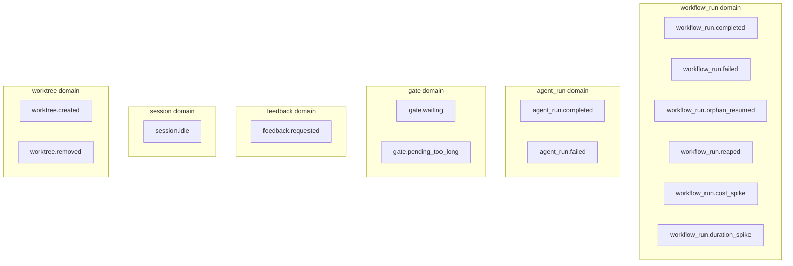
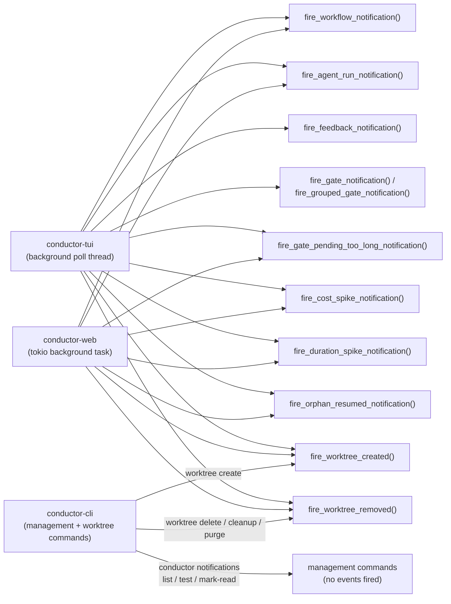
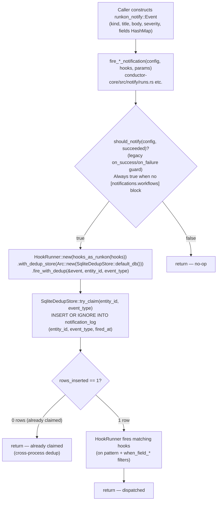
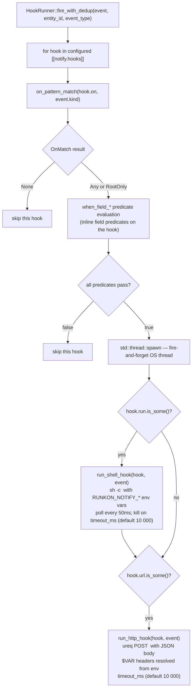
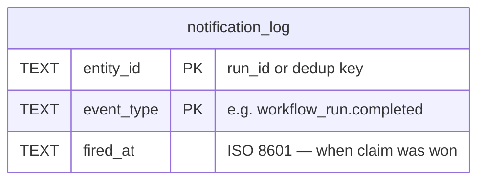

# Notification Hooks — Architecture Reference

> Source files: `conductor-core/src/notify/catalog.rs`, `conductor-core/src/notify/event.rs`, `conductor-core/src/notify/dedup.rs`, `conductor-core/src/notify/runs.rs`, `conductor-core/src/notify/anomalies.rs`, `conductor-core/src/notify/gates.rs`

This document covers the full conductor notification system: every event type and what fires it, which binaries participate, the dispatch pipeline from event construction to hook execution, filter resolution logic, and the DB table involved.

Conductor's notification dispatch is powered by the [`runkon-notify`](https://crates.io/crates/runkon-notify) crate. All in-tree notification code has been removed in favour of the upstream library.

---

## Diagram 1 — Event type taxonomy

All event kinds, grouped by domain. Events are `runkon_notify::Event` envelopes — a plain struct with `kind`, `title`, `body`, `severity`, and a `fields: HashMap<String, String>`. There is no longer a `NotificationEvent` enum in conductor-core.



The `EVENTS` registry in `conductor-core/src/notify/catalog.rs` is the single list of events a hook can match, with each event's fields; `conductor notify events` prints it and the field tables below are generated from it. Drift tests build every event through the real producers and fail when a kind or field is missing from the registry. The hook × event matrix UI uses the non-threshold events; `workflow_run.cost_spike`, `workflow_run.duration_spike`, and `gate.pending_too_long` require threshold filter fields and are excluded from it.

---

## Diagram 2 — Binary participation

Which binaries fire which notification functions, all of which ultimately call `HookRunner::fire_with_dedup()` from `runkon-notify`.



All fire functions are defined in `conductor-core/src/notify/` and re-exported from `conductor-core/src/notify/mod.rs`.

---

## Diagram 3 — Full dispatch pipeline

The sequence from event construction through dedup and hook execution.



### HookRunner::fire_with_dedup — per-hook thread spawn



All failures in `run_shell_hook` and `run_http_hook` are logged as `tracing::warn!` and never propagated — hooks are best-effort.

`HookRunner` is provided by `runkon-notify`; it is re-exported from `conductor-core::notify::HookRunner` for use by binaries.

---

## Diagram 4 — Hook filter resolution

Conductor's `HookConfig` (TOML config struct) is translated to `runkon_notify::HookConfig` at dispatch time via `HookConfig::to_runkon_hook_config()`. Filters are encoded as `when_field_*` predicates on the `runkon_notify::HookConfig`; the upstream library evaluates them per event.

```mermaid
flowchart TD
    A["to_runkon_hook_config() — translate conductor HookConfig\nto runkon_notify::HookConfig with when_field_* predicates"]

    B{"root_workflows_only = true?"}
    C["Append :root suffix to each on arm\ne.g. workflow_run.* → workflow_run.*:root"]

    D{"workflow filter set?"}
    E["when_field_eq = (workflow_name, value)"]

    F{"repo filter set?"}
    G["when_field_in = (repo_slug, [value])"]

    H{"step filter set?"}
    I["when_field_in = (step_name, [value])"]

    J{"branch filter set?"}
    K["when_field_glob = (branch, pattern)"]

    L{"threshold_multiple set?"}
    M["when_field_gte = (multiple, value)"]

    N{"gate_pending_ms set?"}
    O["when_field_gte = (pending_ms, value)"]

    P["runkon_notify::HookConfig ready for dispatch"]

    A --> B
    B -->|"yes"| C
    B -->|"no"| D
    C --> D
    D -->|"yes"| E
    D -->|"no"| F
    E --> F
    F -->|"yes"| G
    F -->|"no"| H
    G --> H
    H -->|"yes"| I
    H -->|"no"| J
    I --> J
    J -->|"yes"| K
    J -->|"no"| L
    K --> L
    L -->|"yes"| M
    L -->|"no"| N
    M --> N
    N -->|"yes"| O
    N -->|"no"| P
    O --> P
```



### `on` pattern matching

The `on` field accepts a comma-separated list of patterns. Each sub-pattern may carry a `:root` suffix (injected automatically when `root_workflows_only = true`):

| Pattern | Matches |
|---|---|
| `*` | All events |
| `workflow_run.*` | Any `workflow_run.` event |
| `agent_run.*` | Any `agent_run.` event |
| `gate.*` | Any `gate.` event |
| `gate.waiting` | Exact event name |
| `session.*` | Any `session.` event (`session.idle`) |
| `workflow_run.completed:root` | Only root workflow completions (no parent) |
| `workflow_run.*:root` | All workflow events, root runs only |
| `feature/*` | Branch glob (used in `branch` filter, not `on`) |

An `on` arm that matches no event never fires. Loading the config logs a warning for each one, naming the valid events.

The `:root` suffix causes `runkon-notify` to check that `event.fields["is_root"] == "true"`. Producers set this field when `parent_workflow_run_id.is_none()`. The `root_workflows_only` conductor config field is translated to `:root`-suffixed `on` arms at dispatch time; it is not a separate runtime check.

---

## Diagram 5 — DB table write paths



**Write sequence:**

1. `notification_log` — written via `INSERT OR IGNORE` inside `SqliteDedupStore::try_claim`. Composite PK `(entity_id, event_type)` is the cross-process lock. If a row already exists for `(run_id, "workflow_run.completed")`, the second caller's insert returns 0 rows and `fire_with_dedup` skips hook execution entirely.

**Indexes** (migration `046_notifications.sql`):
- `idx_notification_log` on `notification_log(entity_id, event_type)` — dedup lookup

`SqliteDedupStore` opens a fresh `rusqlite::Connection` per `try_claim` call (no shared mutex needed; SQLite WAL mode handles concurrent writers).

---

## Shell hook environment variables

All variables are injected into shell hook commands by `runkon-notify` when a hook fires.

> **Renamed from `CONDUCTOR_*`:** Prior to the `runkon-notify` adoption, shell hooks received `CONDUCTOR_EVENT`, `CONDUCTOR_RUN_ID`, etc. These have been replaced by the `RUNKON_NOTIFY_*` prefix. Update any existing hook scripts that reference the old variable names.

### Envelope fields (all events)

| Variable | Value | Notes |
|---|---|---|
| `RUNKON_NOTIFY_KIND` | `workflow_run.completed` etc. | Dotted event kind |
| `RUNKON_NOTIFY_TITLE` | `"Conductor — Workflow Completed"` | Human-readable title |
| `RUNKON_NOTIFY_BODY` | `"my-wf on repo/branch"` | Human-readable body |
| `RUNKON_NOTIFY_SEVERITY` | `info` / `warning` / `error` | Severity level |

### Event fields (via `RUNKON_NOTIFY_FIELD_<UPPER_KEY>`)

All entries in the event `fields` map are injected as `RUNKON_NOTIFY_FIELD_<UPPER_KEY>`. For example, a field `run_id` becomes `RUNKON_NOTIFY_FIELD_RUN_ID`. There are no fields common to every event: each event sets the ones listed under it. Run `conductor notify events` (add `--json` for scripts) to print the same list.

"Always set" is `no` when a variant or condition can leave the field out; the description says which. A field that is always set can still be an empty string.

<!-- BEGIN GENERATED: notify-events -->
#### `workflow_run.completed`

A workflow run finished successfully. (supports `:root`)

| Variable | Always set | Description |
|---|---|---|
| `RUNKON_NOTIFY_FIELD_RUN_ID` | yes | Workflow run ID |
| `RUNKON_NOTIFY_FIELD_WORKFLOW_NAME` | yes | Workflow name |
| `RUNKON_NOTIFY_FIELD_PARENT_WORKFLOW_RUN_ID` | yes | Parent workflow run ID; empty for root runs |
| `RUNKON_NOTIFY_FIELD_REPO_SLUG` | yes | Repository slug |
| `RUNKON_NOTIFY_FIELD_BRANCH` | yes | Branch name |
| `RUNKON_NOTIFY_FIELD_DURATION_MS` | yes | Run duration in ms; empty when unknown |
| `RUNKON_NOTIFY_FIELD_TICKET_URL` | yes | Linked ticket URL; empty when none |
| `RUNKON_NOTIFY_FIELD_URL` | yes | Web UI deep link; empty when `[web] url` is not set |
| `RUNKON_NOTIFY_FIELD_TIMESTAMP` | yes | RFC 3339 time the event was built |
| `RUNKON_NOTIFY_FIELD_IS_ROOT` | yes | `true` when the run has no parent, else `false` |

#### `workflow_run.failed`

A workflow run failed. (supports `:root`)

| Variable | Always set | Description |
|---|---|---|
| `RUNKON_NOTIFY_FIELD_RUN_ID` | yes | Workflow run ID |
| `RUNKON_NOTIFY_FIELD_WORKFLOW_NAME` | yes | Workflow name |
| `RUNKON_NOTIFY_FIELD_PARENT_WORKFLOW_RUN_ID` | yes | Parent workflow run ID; empty for root runs |
| `RUNKON_NOTIFY_FIELD_REPO_SLUG` | yes | Repository slug |
| `RUNKON_NOTIFY_FIELD_BRANCH` | yes | Branch name |
| `RUNKON_NOTIFY_FIELD_DURATION_MS` | yes | Run duration in ms; empty when unknown |
| `RUNKON_NOTIFY_FIELD_TICKET_URL` | yes | Linked ticket URL; empty when none |
| `RUNKON_NOTIFY_FIELD_URL` | yes | Web UI deep link; empty when `[web] url` is not set |
| `RUNKON_NOTIFY_FIELD_TIMESTAMP` | yes | RFC 3339 time the event was built |
| `RUNKON_NOTIFY_FIELD_IS_ROOT` | yes | `true` when the run has no parent, else `false` |
| `RUNKON_NOTIFY_FIELD_CAUSE` | no | Nested failing step, e.g. `workflow:review-pr › submit-review: exited 1`; set only when one was found |
| `RUNKON_NOTIFY_FIELD_ERROR` | no | Error message, ending with ` — cause: <cause>` when a cause was found; set only when there is an error or cause |

#### `workflow_run.reaped`

A stuck workflow run was reaped and could not be auto-resumed.

| Variable | Always set | Description |
|---|---|---|
| `RUNKON_NOTIFY_FIELD_RUN_ID` | yes | Workflow run ID |
| `RUNKON_NOTIFY_FIELD_WORKFLOW_NAME` | yes | Workflow name |
| `RUNKON_NOTIFY_FIELD_REPO_SLUG` | yes | Repository slug |
| `RUNKON_NOTIFY_FIELD_BRANCH` | yes | Branch name |
| `RUNKON_NOTIFY_FIELD_ERROR` | yes | Why the run could not be resumed |
| `RUNKON_NOTIFY_FIELD_TIMESTAMP` | yes | RFC 3339 time the event was built |

#### `workflow_run.orphan_resumed`

Orphaned or stuck workflow runs were automatically resumed on startup.

| Variable | Always set | Description |
|---|---|---|
| `RUNKON_NOTIFY_FIELD_RUN_ID` | yes | First resumed workflow run ID |
| `RUNKON_NOTIFY_FIELD_WORKFLOW_NAME` | yes | Workflow name |
| `RUNKON_NOTIFY_FIELD_REPO_SLUG` | yes | Repository slug |
| `RUNKON_NOTIFY_FIELD_BRANCH` | yes | Branch name |
| `RUNKON_NOTIFY_FIELD_TIMESTAMP` | yes | RFC 3339 time the event was built |

#### `workflow_run.cost_spike`

A completed workflow run cost a multiple of its baseline. (supports `:root`; needs `threshold_multiple` on the hook)

| Variable | Always set | Description |
|---|---|---|
| `RUNKON_NOTIFY_FIELD_RUN_ID` | yes | Workflow run ID |
| `RUNKON_NOTIFY_FIELD_WORKFLOW_NAME` | yes | Workflow name |
| `RUNKON_NOTIFY_FIELD_PARENT_WORKFLOW_RUN_ID` | yes | Parent workflow run ID; empty for root runs |
| `RUNKON_NOTIFY_FIELD_REPO_SLUG` | yes | Repository slug |
| `RUNKON_NOTIFY_FIELD_BRANCH` | yes | Branch name |
| `RUNKON_NOTIFY_FIELD_DURATION_MS` | yes | Run duration in ms; empty when unknown |
| `RUNKON_NOTIFY_FIELD_URL` | yes | Web UI deep link; empty when `[web] url` is not set |
| `RUNKON_NOTIFY_FIELD_TIMESTAMP` | yes | RFC 3339 time the event was built |
| `RUNKON_NOTIFY_FIELD_MULTIPLE` | yes | Multiple over the baseline, e.g. `3.5` |
| `RUNKON_NOTIFY_FIELD_IS_ROOT` | yes | `true` when the run has no parent, else `false` |
| `RUNKON_NOTIFY_FIELD_COST_USD` | yes | Run cost in USD |

#### `workflow_run.duration_spike`

A completed workflow run took a multiple of its baseline duration. (supports `:root`; needs `threshold_multiple` on the hook)

| Variable | Always set | Description |
|---|---|---|
| `RUNKON_NOTIFY_FIELD_RUN_ID` | yes | Workflow run ID |
| `RUNKON_NOTIFY_FIELD_WORKFLOW_NAME` | yes | Workflow name |
| `RUNKON_NOTIFY_FIELD_PARENT_WORKFLOW_RUN_ID` | yes | Parent workflow run ID; empty for root runs |
| `RUNKON_NOTIFY_FIELD_REPO_SLUG` | yes | Repository slug |
| `RUNKON_NOTIFY_FIELD_BRANCH` | yes | Branch name |
| `RUNKON_NOTIFY_FIELD_DURATION_MS` | yes | Run duration in ms; empty when unknown |
| `RUNKON_NOTIFY_FIELD_URL` | yes | Web UI deep link; empty when `[web] url` is not set |
| `RUNKON_NOTIFY_FIELD_TIMESTAMP` | yes | RFC 3339 time the event was built |
| `RUNKON_NOTIFY_FIELD_MULTIPLE` | yes | Multiple over the baseline, e.g. `3.5` |
| `RUNKON_NOTIFY_FIELD_IS_ROOT` | yes | `true` when the run has no parent, else `false` |

#### `agent_run.completed`

A standalone agent run finished successfully (not fired for interactive sessions).

| Variable | Always set | Description |
|---|---|---|
| `RUNKON_NOTIFY_FIELD_RUN_ID` | yes | Agent run ID |
| `RUNKON_NOTIFY_FIELD_REPO_SLUG` | yes | Repository slug |
| `RUNKON_NOTIFY_FIELD_BRANCH` | yes | Branch name |
| `RUNKON_NOTIFY_FIELD_DURATION_MS` | yes | Run duration in ms; empty when unknown |
| `RUNKON_NOTIFY_FIELD_TICKET_URL` | yes | Linked ticket URL; empty when none |
| `RUNKON_NOTIFY_FIELD_TIMESTAMP` | yes | RFC 3339 time the event was built |

#### `agent_run.failed`

A standalone agent run failed.

| Variable | Always set | Description |
|---|---|---|
| `RUNKON_NOTIFY_FIELD_RUN_ID` | yes | Agent run ID |
| `RUNKON_NOTIFY_FIELD_REPO_SLUG` | yes | Repository slug |
| `RUNKON_NOTIFY_FIELD_BRANCH` | yes | Branch name |
| `RUNKON_NOTIFY_FIELD_DURATION_MS` | yes | Run duration in ms; empty when unknown |
| `RUNKON_NOTIFY_FIELD_TICKET_URL` | yes | Linked ticket URL; empty when none |
| `RUNKON_NOTIFY_FIELD_TIMESTAMP` | yes | RFC 3339 time the event was built |
| `RUNKON_NOTIFY_FIELD_ERROR` | no | Error message; set only when the run recorded one |

#### `gate.waiting`

A workflow gate is waiting for a person (approval, review, CI).

| Variable | Always set | Description |
|---|---|---|
| `RUNKON_NOTIFY_FIELD_RUN_ID` | yes | Workflow step ID for a single gate, workflow run ID for a grouped notification |
| `RUNKON_NOTIFY_FIELD_STEP_NAME` | yes | Gate step name, or `<n> gates pending` for a grouped notification |
| `RUNKON_NOTIFY_FIELD_REPO_SLUG` | no | Repository slug; single-gate notifications only |
| `RUNKON_NOTIFY_FIELD_BRANCH` | no | Branch name; single-gate notifications only |
| `RUNKON_NOTIFY_FIELD_TICKET_URL` | no | Linked ticket URL, empty when none; single-gate notifications only |
| `RUNKON_NOTIFY_FIELD_COUNT` | no | Number of gates pending in the run; grouped notifications only |
| `RUNKON_NOTIFY_FIELD_TIMESTAMP` | yes | RFC 3339 time the event was built |

#### `gate.pending_too_long`

A gate has been waiting longer than `gate_pending_ms` (default 30 minutes). (needs `gate_pending_ms` on the hook)

| Variable | Always set | Description |
|---|---|---|
| `RUNKON_NOTIFY_FIELD_RUN_ID` | yes | Workflow run ID |
| `RUNKON_NOTIFY_FIELD_STEP_NAME` | yes | Gate step name |
| `RUNKON_NOTIFY_FIELD_REPO_SLUG` | yes | Repository slug |
| `RUNKON_NOTIFY_FIELD_BRANCH` | yes | Branch name |
| `RUNKON_NOTIFY_FIELD_DURATION_MS` | yes | Run duration in ms; empty when unknown |
| `RUNKON_NOTIFY_FIELD_URL` | yes | Web UI deep link; empty when `[web] url` is not set |
| `RUNKON_NOTIFY_FIELD_TIMESTAMP` | yes | RFC 3339 time the event was built |
| `RUNKON_NOTIFY_FIELD_PENDING_MS` | yes | How long the gate has been waiting, in ms |

#### `feedback.requested`

An agent asked for feedback and is blocked on the answer.

| Variable | Always set | Description |
|---|---|---|
| `RUNKON_NOTIFY_FIELD_RUN_ID` | yes | The agent run that asked |
| `RUNKON_NOTIFY_FIELD_FEEDBACK_ID` | yes | Feedback request ID |
| `RUNKON_NOTIFY_FIELD_PROMPT_PREVIEW` | yes | First ~100 chars of the prompt |
| `RUNKON_NOTIFY_FIELD_REPO_SLUG` | yes | Repository slug, resolved from the agent run |
| `RUNKON_NOTIFY_FIELD_BRANCH` | yes | Branch name; empty for repo-scoped agents |
| `RUNKON_NOTIFY_FIELD_WORKTREE_SLUG` | yes | Worktree slug; empty for repo-scoped agents |
| `RUNKON_NOTIFY_FIELD_TIMESTAMP` | yes | RFC 3339 time the event was built |

#### `session.idle`

An interactive session finished a turn and has stayed idle for `delay_secs`.

| Variable | Always set | Description |
|---|---|---|
| `RUNKON_NOTIFY_FIELD_RUN_ID` | yes | The agent run |
| `RUNKON_NOTIFY_FIELD_SESSION_ID` | yes | Claude Code session ID; empty when unknown |
| `RUNKON_NOTIFY_FIELD_REPO_SLUG` | yes | Repository slug |
| `RUNKON_NOTIFY_FIELD_BRANCH` | yes | Branch name |
| `RUNKON_NOTIFY_FIELD_WORKTREE_SLUG` | yes | Worktree slug; empty when none |
| `RUNKON_NOTIFY_FIELD_PROMPT_PREVIEW` | yes | First ~100 chars of the turn's prompt |
| `RUNKON_NOTIFY_FIELD_LAST_MESSAGE_PREVIEW` | yes | First ~100 chars of the last assistant message |
| `RUNKON_NOTIFY_FIELD_BACKGROUND_TASKS` | yes | Background tasks still running at `Stop` (`0` when none) |
| `RUNKON_NOTIFY_FIELD_TURN_DURATION_MS` | yes | Prompt to `Stop` in ms; empty when unknown |
| `RUNKON_NOTIFY_FIELD_IDLE_SINCE` | yes | RFC 3339 time of the `Stop` |
| `RUNKON_NOTIFY_FIELD_TIMESTAMP` | yes | RFC 3339 time the event was built |

#### `worktree.created`

A worktree checkout was created (not fired when an existing checkout is adopted).

| Variable | Always set | Description |
|---|---|---|
| `RUNKON_NOTIFY_FIELD_REPO_SLUG` | yes | Repository slug |
| `RUNKON_NOTIFY_FIELD_WORKTREE_SLUG` | yes | Worktree slug |
| `RUNKON_NOTIFY_FIELD_WORKTREE_ID` | yes | Conductor worktree ID |
| `RUNKON_NOTIFY_FIELD_BRANCH` | yes | Branch name |
| `RUNKON_NOTIFY_FIELD_PATH` | yes | Absolute checkout path |
| `RUNKON_NOTIFY_FIELD_BASE_BRANCH` | yes | Base branch; empty when none |
| `RUNKON_NOTIFY_FIELD_PR_NUMBER` | yes | PR number when created with `--from-pr`; empty otherwise |
| `RUNKON_NOTIFY_FIELD_TIMESTAMP` | yes | RFC 3339 time the event was built |

#### `worktree.removed`

A worktree's folder and branch were removed (delete, cleanup, ticket sync or purge); fires once per worktree.

| Variable | Always set | Description |
|---|---|---|
| `RUNKON_NOTIFY_FIELD_REPO_SLUG` | yes | Repository slug |
| `RUNKON_NOTIFY_FIELD_WORKTREE_SLUG` | yes | Worktree slug |
| `RUNKON_NOTIFY_FIELD_WORKTREE_ID` | yes | Conductor worktree ID |
| `RUNKON_NOTIFY_FIELD_BRANCH` | yes | Branch name |
| `RUNKON_NOTIFY_FIELD_PATH` | yes | Absolute checkout path; still set after the folder is gone |
| `RUNKON_NOTIFY_FIELD_BASE_BRANCH` | yes | Base branch; empty when none |
| `RUNKON_NOTIFY_FIELD_PR_NUMBER` | yes | Merged PR number when known (cleanup and ticket sync); empty otherwise |
| `RUNKON_NOTIFY_FIELD_REASON` | yes | `merged`, `abandoned` or `deleted` (record purged without an earlier removal event) |
| `RUNKON_NOTIFY_FIELD_TIMESTAMP` | yes | RFC 3339 time the event was built |

<!-- END GENERATED: notify-events -->

### Worktree events

`worktree.created` and `worktree.removed` fire from `conductor-core`'s worktree code, so the CLI, MCP, TUI, web, ticket sync and the background merged-PR cleanup all fire them. The fields are listed under each event above.

- `worktree.created` fires after the checkout, dependency install and database row exist. `worktree adopt` does not fire it.
- `worktree.removed` fires after the folder and branch are gone: from `worktree delete`, `worktree cleanup` (merged PRs), closed-ticket sync, stale-worktree reaping and `worktree purge`. `path` stays set so a hook can match caches keyed by the checkout path.
- `reason` is `merged` (the worktree ended merged), `abandoned` (deleted while unmerged) or `deleted` (`purge` removed a completed record whose removal was never announced, such as one completed before these events existed, so a hook can clean up after worktrees that are already gone). The first `purge` after an upgrade can therefore fire many events in a row.
- Bulk removals (`cleanup`, reaping, `purge`, ticket sync) wait for each worktree's hooks before moving to the next, so N removals can take up to N times the hooks' timeouts. Hooks of different worktrees never overlap, so cleanup scripts can share caches or simulators safely.
- `worktree.removed` fires once per worktree ID, deduped in `notification_log`, even when several processes clean up at once. With no hooks configured nothing is recorded, so a hook added later still hears about old records when they are purged.
- These hooks run synchronously: the command that triggered the event waits for them, up to the longest hook `timeout_ms` (default 10 s) plus a short grace period, so a short-lived CLI command doesn't exit before the hook runs.
- A failing or timed-out hook is logged and never stops the create or removal.
- Unlike other events, a hook with both `run` and `url` runs only its `run` command for worktree events.

Example: remove per-worktree build caches when a worktree goes away.

```toml
[[notify.hooks]]
on = "worktree.removed"
run = 'rm -rf "$HOME/.cache/my-builds/$RUNKON_NOTIFY_FIELD_WORKTREE_SLUG"'
```

### `session.idle`

Fires when an interactive Claude Code session (RFC 021) finished a turn and has stayed idle for `delay_secs`: the developer's move. It is separate from `feedback.requested` (blocked on a permission prompt), so a hook can route or silence it with its own `on` filter.

The fields are listed under `session.idle` above.

The body is `<worktree slug>: <last message preview>`.

Firing rules:

- Only after a `Stop`; never on `SessionStart` (a new or resumed session is idle before any turn), and never for headless runs.
- Only once the session has been idle for `delay_secs`. A prompt within the delay clears the idle period and nothing fires.
- Once per idle period, deduped on `(run_id, idle_since)` in `notification_log`, so the TUI and web running together notify once. A later turn is a new period.
- Sessions with background tasks still notify; the count is in `background_tasks`.
- Idle periods older than 24h when first observed are not announced.
- Needs a sink: `[notifications] enabled = true` or at least one `[[notify.hooks]]`.

```toml
[notifications.session_idle]
delay_secs = 30     # default; 0 fires immediately
web_push = false    # default; true also sends a Web Push
```

Web Push sends `feedback.requested` and gate-waiting by default but not `session.idle`; set `web_push = true` to opt in. Hooks are unaffected by `web_push`.

`agent_run.completed` no longer fires for interactive sessions (closing one is not news); `agent_run.failed` still does.

---

`feedback.requested` and `gate.waiting` hooks fire from the TUI poll loop whether or not `[notifications] enabled` is set. Feedback requests older than 24h when first observed are not announced.

## HTTP hook payload

HTTP hooks receive a JSON POST body built from the `runkon_notify::Event` fields. Header values starting with `$` are resolved from the process environment (e.g. `Authorization: $SLACK_TOKEN`).

Example for `workflow_run.completed`:

```json
{
  "event": "workflow_run.completed",
  "title": "Conductor — Workflow Completed",
  "body": "ticket-to-pr on conductor-ai/feat-123",
  "severity": "info",
  "fields": {
    "run_id": "01ABCDEF...",
    "timestamp": "2025-04-16T14:00:00Z",
    "url": "https://conductor.example.com/repos/.../runs/...",
    "repo_slug": "conductor-ai",
    "branch": "feat/123",
    "duration_ms": "42000",
    "workflow_name": "ticket-to-pr",
    "ticket_url": "https://github.com/org/repo/issues/123",
    "parent_workflow_run_id": "",
    "is_root": "true"
  }
}
```

See `docs/examples/hooks/` for working shell and HTTP hook examples.

---

## Security model

Shell hooks run user-configured commands via `sh -c <hook.run>`. The command string is read directly from `config.toml` and is **not** validated, sandboxed, or restricted to an allow-list. Event data is passed safely through environment variables, but the hook body itself executes with full shell privileges as the conductor user.

**Threat:** anyone who can write to `~/.conductor/config.toml` — or to a repo-local `.conductor/config.toml` that conductor reads — can achieve arbitrary code execution under the conductor user on the next matching event.

**Implications:**

- Treat conductor config files as trusted input. Do not source them from a shared writable location, and do not check repo-local `.conductor/config.toml` from a branch you would not run code from.
- Untrusted PRs that modify `.conductor/config.toml` should be reviewed for hook additions/changes the same way you would review a `Makefile` change — they are equivalent in privilege.
- HTTP hooks have a smaller blast radius (only the configured URL is reachable; secrets in `$VAR` headers come from the host process environment), but the URL itself is still arbitrary — apply the same trust model to the config file.
- Conductor does not currently provide a hook allow-list, sandbox, or signed-config mechanism. Defense relies on filesystem permissions on the config file.
